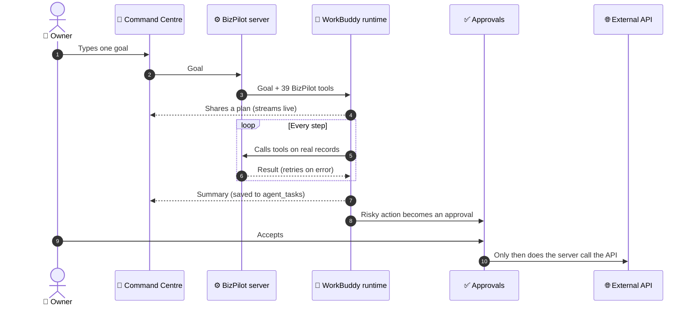
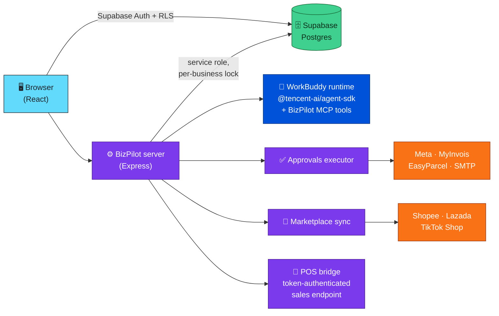

<div align="center">

# 🚀 BizPilot

### SME operations agent powered by WorkBuddy

**One goal in. Real work done. You approve what matters.**

[](https://biz-pilot-eight.vercel.app)
[](#)


</div>

<!-- 📸 Tip: drop a screenshot or GIF of the Command Centre here — it's the single biggest visual upgrade.
<p align="center"></p>
-->

---

## 🧭 What it does

BizPilot runs the day-to-day operations of a **Malaysian SME** (online, retail or both):

| | Area | | Area |
|:-:|---|:-:|---|
| 📦 | Inventory | 🧾 | Invoices & LHDN e-invoicing |
| 🤝 | Suppliers & purchasing | 💰 | Expenses & P&L |
| 🛒 | Sales from Shopee / Lazada / TikTok Shop / POS | ⭐ | Reviews & support |
| 🚚 | Courier booking | 📣 | Marketing content |

> [!NOTE]
> **All data is real (Supabase); there is no sample data.**

---

## 🤖 WorkBuddy is the execution engine

The owner types **one goal** in the Command Centre. BizPilot's server hands it to the WorkBuddy agent runtime together with **39 BizPilot tools**. WorkBuddy shares a plan, calls the tools on the business's real records, retries when a tool reports an error, and finishes with a summary. Every step streams live into the Command Centre and is saved to `agent_tasks`.



> [!IMPORTANT]
> Anything risky — **POs, price changes, posts, customer emails, e-invoices, courier bookings, stock corrections** — becomes an approval the owner accepts in **Approvals**; only then does the server call the external API.

---

## 🏗️ Architecture



---

## 🌐 Put it online

See **[DEPLOY.md](DEPLOY.md)**: web app on **Vercel**, server + WorkBuddy engine on **Render**.

---

## 💻 Run it locally

1. 🗄️ **Database:** follow [SUPABASE_SETUP.md](SUPABASE_SETUP.md) (run `supabase/schema.sql`).
2. 🔑 **Web app env:** copy `.env.example` → `.env` and fill in the Supabase URL and anon key.
3. 🔐 **Server env:** copy `server/.env.example` → `server/.env` and fill in `SUPABASE_URL` and `SUPABASE_SERVICE_ROLE_KEY`.
4. ⚙️ **Start the server:**
   ```bash
   cd server && npm install && npm start   # port 4000
   ```
5. 🖥️ **Start the app:**
   ```bash
   npm install && npm run dev              # → http://localhost:5173
   ```
6. 🤖 **Once only**, sign the server in to BizPilot's WorkBuddy account:
   ```bash
   cd server && npm run workbuddy:login
   ```
   > [!TIP]
   > Users never see this; the whole app runs on that one account.
7. 🔌 Add integrations in **Settings → Integrations** (see [INTEGRATIONS_SETUP.md](INTEGRATIONS_SETUP.md)).
8. 🎯 Go to **Command Centre** and give WorkBuddy a goal.

---

## 🗂️ Where things live

| Path | What |
|---|---|
| 📁 `src/lib/ops.ts` | All business operations (stock, POs, sales, invoices, approvals…). Shared by the UI, the server and WorkBuddy's tools. |
| 📊 `src/lib/metrics.ts` | KPIs, P&L, reorder logic, review stats — computed from real records. |
| 🔄 `src/lib/db/remote.ts` | Supabase load / diff / save of a business workspace. |
| 🤖 `server/src/agent/` | WorkBuddy sign-in, tool definitions, task runner. |
| 🌐 `server/src/providers/` | Real API clients: Shopee, Lazada, TikTok Shop, EasyParcel, MyInvois, Meta, SMTP. |
| ✅ `server/src/lib/execute.ts` | What happens when an approval is approved. |
| 🗄️ `supabase/schema.sql` | Tables, Row Level Security, indexes. |

---

## 🛡️ Safety model (blueprint §12)

| Level | WorkBuddy can… |
|:-:|---|
| 🟢 **1** | Read and recommend only. |
| 🟡 **2** | Draft — every risky action needs approval. |
| 🔵 **3** | Run low-risk POs, review replies and stock corrections **under the approval limit** automatically. |

> [!WARNING]
> - WorkBuddy has **no shell, file or web access**: only BizPilot tools, scoped to the signed-in business.
> - Integration secrets are **only readable by the server** (RLS with no client policy) and never returned to the browser.
> - Every change is written to the **audit log** with who did it (owner, WorkBuddy agent, POS, scheduler).

---

## 👥 Team

| Member | GitHub | Role |
|---|---|---|
| Ng Wei Bin | [@ngweibin050-dev](https://github.com/ngweibin050-dev) | |
| Jian Cheng | [@JianCheng929](https://github.com/JianCheng929) | |
| Lee Kok Meng | [@LKM07](https://github.com/LKM07) | |
| Lew Sean Yew | [@seanyew](https://github.com/seanyew) | |

<div align="center">

Built in 24 hours at **DORMATHON 2026** · Track 2: WorkBuddy — Agentic Solutions

</div>
